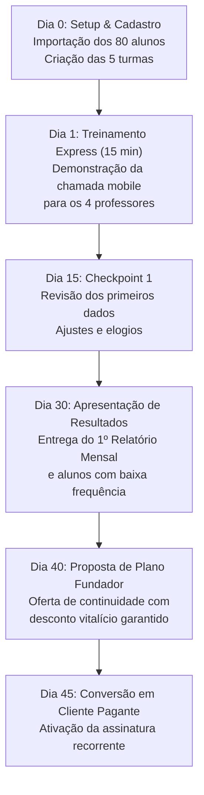
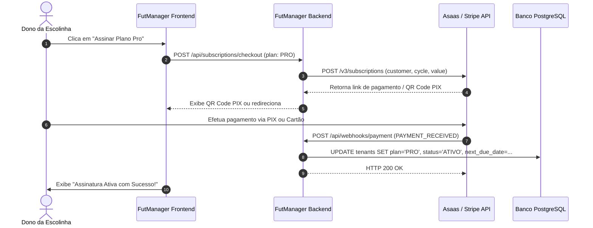

# Guia de Monetização SaaS, Integração de Pagamentos e Estratégia Comercial — FutManager

Este documento apresenta o plano estratégico, comercial e técnico para transformar o **FutManager** em um produto SaaS (Software as a Service) altamente lucrativo, focado em escolinhas de futebol e academias esportivas.

---

## 1. Estratégia do Piloto Gratuito (A 1ª Escolinha: 5 Turmas, 4 Professores, ~80 Alunos)

Você está iniciando da forma mais inteligente: validando o produto no campo real com uma escolinha de porte representativo. Uma escolinha com **5 turmas, 4 professores e 80 alunos** é o tamanho perfeito para validar:
1. A usabilidade da chamada no celular pelos 4 professores.
2. A satisfação da coordenação com os relatórios e históricos de frequência.
3. A integridade das regras (alunos Sub-9 separados de Sub-11, unicidade dos responsáveis por telefone).

### 1.1. O Acordo do Piloto Beta (Como não parecer "de graça por desespero")
Nunca ofereça dizendo *"Tô testando um sistema, quer usar de graça?"*. Posicione como uma **oportunidade exclusiva de parceria de lançamento**:

> **Exemplo de abordagem para o dono/coordenador:**
> *"Professor Carlos, estamos lançando uma plataforma profissional desenvolvida exclusivamente para gestão de chamadas e controle de faltas de escolinhas de futebol, 100% no celular. Selecionamos apenas 2 escolinhas de destaque na região para o nosso Programa de Parceiros Fundadores: você terá acesso completo gratuito por 45 dias para suas 5 turmas, com implantação acompanhada e suporte direto comigo. Em troca, a única coisa que pedimos é o feedback semanal dos seus 4 professores e, se vocês gostarem, um depoimento curto para divulgarmos como caso de sucesso."*

### 1.2. Cronograma de Acompanhamento (45 Dias)


### 1.3. A Psicologia da Conversão (Por que eles vão pagar?)
Após 45 dias:
- Os 4 professores estarão acostumados a fazer a chamada em 40 segundos no próprio celular.
- A coordenação terá todos os relatórios na mão para cobrar mensalidades e justificar faltas para os pais.
- Se eles parassem de usar, teriam que voltar para a prancheta de papel molhado e planilhas desatualizadas.
- O custo do sistema (ex: R$ 149 ou R$ 179/mês) representa **menos de 1 ou 2 mensalidades de alunos** (que pagam entre R$ 120 e R$ 250/mês cada). Se o sistema evitar a evasão de apenas 1 aluno por mês, ele já se paga sozinho!

---

## 2. Modelos de Precificação (Pricing SaaS B2B)

Para escolinhas de futebol no Brasil, o modelo que mais converte é o **escalonado por alunos ativos** ou **plano fixo com base no porte**:

### Tabela de Planos Recomendada

| Plano | Alunos Ativos | Turmas & Professores | Preço Mensal | Preço Anual (2 meses off) | Público-Alvo |
| :--- | :---: | :---: | :---: | :---: | :--- |
| **Starter** | Até 50 alunos | Até 3 turmas, 2 professores | **R$ 97 / mês** | R$ 970 / ano | Escolinhas iniciantes ou projetos sociais |
| **Pro** ⭐ | **Até 120 alunos** | **Turmas e professores ilimitados** | **R$ 169 / mês** | **R$ 1.690 / ano** | **Tamanho da sua escolinha piloto (80 alunos)** |
| **Master** | Até 250 alunos | Turmas e professores ilimitados + Exportações avançadas | **R$ 279 / mês** | R$ 2.790 / ano | Escolinhas tradicionais de médio porte |
| **Elite** | Acima de 250 alunos | Múltiplas unidades / Franquias | **R$ 449+ / mês** | R$ 4.490 / ano | Franquias de grandes clubes (Flamengo, Santos, etc.) |

> [!TIP]
> **Oferta de Conversão para a Escolinha Piloto (Plano Fundador):**
> O Plano Pro custa R$ 169/mês. Para a escolinha piloto, você oferece:
> - **R$ 129 / mês** no pagamento mensal vitalício, **OU**
> - **R$ 1.290 à vista no anual** (equivalente a R$ 107/mês, gerando caixa imediato para você).

### Projeção de Faturamento Recorrente (MRR)
- **5 escolinhas** no Plano Pro: R$ 845 / mês (R$ 10.140 / ano)
- **15 escolinhas**: R$ 2.535 / mês (R$ 30.420 / ano)
- **30 escolinhas**: R$ 5.070 / mês (R$ 60.840 / ano)
- **60 escolinhas**: R$ 10.140 / mês (R$ 121.680 / ano)
*(O custo de infraestrutura no plano pago do Render + Supabase para 60 escolinhas fica em menos de R$ 150/mês, garantindo margem líquida superior a 95%).*

---

## 3. Comparativo de Meios de Pagamento no Brasil

Para SaaS B2B no Brasil, você precisa de uma plataforma focada em **recorrência** (cobrança mensal automática) via **PIX**, **Cartão de Crédito** e **Boleto**.

| Critério | **Asaas (Recomendado)** 🏆 | **Stripe** | **Mercado Pago** |
| :--- | :--- | :--- | :--- |
| **Foco de Mercado** | Recorrência B2B no Brasil | Cartão de crédito global | E-commerce / Varejo |
| **Taxa PIX** | R$ 0,99 a R$ 1,89 por transação liquidada | 3,99% + R$ 0,39 | 0,99% |
| **Taxa Boleto** | R$ 1,99 fixo por boleto pago | Não recomendado | R$ 3,49 fixo |
| **Taxa Cartão** | 2,99% + R$ 0,49 | 3,99% + R$ 0,39 | 3,99% a 4,99% |
| **Régua de Cobrança** | **Nativa por WhatsApp, SMS e E-mail** (O próprio Asaas avisa antes e cobra após vencer) | Apenas e-mail | Básica |
| **Mensalidade** | **Zero** (só paga taxa quando recebe) | **Zero** | **Zero** |
| **Facilidade de API** | Muito simples (docs em português) | Excelente (referência mundial) | Moderada |

### Por que o Asaas é a melhor escolha para o FutManager?
1. Donos de escolinhas de futebol preferem pagar via **PIX** ou **Boleto Bancário**. O Asaas permite emitir a assinatura onde o cliente recebe o PIX Copia e Cola todo mês automaticamente no WhatsApp.
2. A régua de cobrança automática por WhatsApp reduz a inadimplência a quase zero sem você precisar cobrar manualmente.
3. Não tem taxa de adesão nem mensalidade mínima.

---

## 4. Arquitetura Técnica de Integração

### 4.1. Fluxo de Assinatura e Webhooks


### 4.2. Alterações no Banco de Dados (`tenants`)
Para armazenar os dados de faturamento, você pode criar uma migration Flyway (`V5__add_billing_fields.sql`):
```sql
ALTER TABLE tenants
ADD COLUMN IF NOT EXISTS customer_gateway_id VARCHAR(100),
ADD COLUMN IF NOT EXISTS subscription_gateway_id VARCHAR(100),
ADD COLUMN IF NOT EXISTS billing_cycle VARCHAR(20) DEFAULT 'MONTHLY',
ADD COLUMN IF NOT EXISTS next_due_date DATE,
ADD COLUMN IF NOT EXISTS payment_status VARCHAR(30) DEFAULT 'TRIAL';
```

### 4.3. Implementação do Webhook no Spring Boot (Exemplo Real Asaas)
```java
@RestController
@RequestMapping("/api/webhooks/asaas")
@RequiredArgsConstructor
@Slf4j
public class AsaasWebhookController {

    private final TenantRepository tenantRepository;

    @Value("${asaas.webhook.access-token}")
    private String webhookSecretToken;

    @PostMapping
    public ResponseEntity<Void> handleAsaasEvent(
            @RequestHeader(value = "asaas-access-token", required = false) String token,
            @RequestBody Map<String, Object> payload) {

        // 1. Validação de segurança do webhook
        if (webhookSecretToken != null && !webhookSecretToken.equals(token)) {
            log.warn("Webhook Asaas não autorizado recebido.");
            return ResponseEntity.status(HttpStatus.UNAUTHORIZED).build();
        }

        String event = (String) payload.get("event");
        Map<String, Object> payment = (Map<String, Object>) payload.get("payment");

        if (payment != null) {
            String customerId = (String) payment.get("customer");
            log.info("Evento Asaas recebido: {} para o cliente: {}", event, customerId);

            // 2. Trata eventos de pagamento
            if ("PAYMENT_RECEIVED".equals(event) || "PAYMENT_CONFIRMED".equals(event)) {
                tenantRepository.findByCustomerGatewayId(customerId).ifPresent(tenant -> {
                    tenant.setStatus("ATIVO");
                    tenant.setPaymentStatus("ACTIVE");
                    tenantRepository.save(tenant);
                    log.info("Escolinha {} ativada com sucesso via webhook!", tenant.getName());
                });
            } else if ("PAYMENT_OVERDUE".equals(event)) {
                tenantRepository.findByCustomerGatewayId(customerId).ifPresent(tenant -> {
                    tenant.setPaymentStatus("OVERDUE");
                    tenantRepository.save(tenant);
                    log.warn("Mensalidade da escolinha {} em atraso.", tenant.getName());
                });
            }
        }

        return ResponseEntity.ok().build();
    }
}
```

---

## 5. Como Vender para Novas Escolinhas (Roteiro Comercial)

### 5.1. Onde Encontrar Clientes
1. **Google Maps**: Pesquise por *"Escolinha de futebol"*, *"Centro de treinamento infantil"*, *"Quadra de society"*. Quase todas têm telefone de WhatsApp comercial cadastrado.
2. **Instagram**: Busque hashtags como `#escolinhadefutebol`, `#futeboldebase`, `#sub9`, `#sub11`. Olhe o perfil de escolinhas locais da sua cidade/estado.
3. **Franquias e Polos**:
   - Escolas Zico 10
   - Chute Inicial Corinthians
   - Meninos da Vila (Santos)
   - Escolinha Fla (Flamengo)
   - Ronaldo Academy
   - Inter Academy

### 5.2. As 3 Dores Reais do Dono da Escolinha (O que falar na abordagem)
1. **Dor 1 (Prancheta vs Celular):** *"Hoje o professor faz chamada em folha de papel que molha no campo, amassa e depois ninguém digita no computador."*
2. **Dor 2 (Conflito com os pais):** *"Quando um pai reclama que o filho faltou ou que não treinou, a escolinha não tem um histórico profissional com foto, data e hora exata para comprovar."*
3. **Dor 3 (Inadimplência e frequência):** *"Muitos alunos faltam dias seguidos e acabam cancelando a matrícula. Com o alerta de baixa frequência do FutManager, a escolinha identifica o aluno antes que ele abandone."*

### 5.3. Script Pronto de Mensagem para WhatsApp
> *"Olá, professor [Nome], tudo bem? Vi o trabalho excelente da [Nome da Escolinha] aqui na região!*
>
> *Eu desenvolvi o **FutManager**, um sistema feito especificamente para escolinhas de futebol acabarem com a prancheta de papel. Os professores fazem a chamada em 30 segundos pelo próprio celular no campo, com foto dos alunos, controle por categoria (Sub-7 até Sub-15) e relatórios automáticos para os pais.*
>
> *Posso te mandar um vídeo de 1 minuto mostrando como funciona no celular? Se gostar, libero um teste sem custo nenhum para suas turmas esta semana."*

---

## 6. Próximos Passos Recomendados
1. **Implantar o piloto na sua 1ª escolinha**: Cadastre os 80 alunos e as 5 turmas, passe os logins para os 4 professores e acompanhe os primeiros 7 dias.
2. **Coletar fotos e depoimentos**: Grave a tela do professor fazendo a chamada no campo para usar nos seus stories e anúncios futuros.
3. **Criar a conta no Asaas**: Cadastre-se gratuitamente no [asaas.com](https://www.asaas.com) como pessoa física ou PJ (MEI) para poder gerar cobranças e links recorrentes.
4. **Fechar a 1ª venda**: No 30º dia de uso da escolinha piloto, apresente o relatório consolidado do mês e feche a assinatura do Plano Pro!
