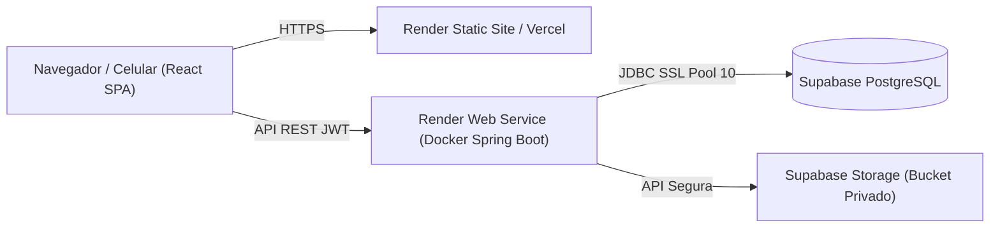

# ⚽ FutManager - Sistema de Gestão de Chamadas para Escolinha de Futebol

FutManager é um sistema web full stack desenvolvido sob medida para a gestão operacional e controle de chamadas e frequência de escolinhas de futebol infantojuvenis. 

O foco central é proporcionar uma **experiência de chamada rápida, intuitiva e confortável em smartphones** na beira do campo, com total rastreabilidade, auditoria de autoria, proteção contra edições concorrentes e regras rigorosas de cálculo de frequência consolidada.

---

## 🛠️ Tecnologias e Arquitetura

O sistema adota uma arquitetura monolítica moderna, modular, de baixo custo e alta manutenibilidade:

- **Backend:** Java 21, Spring Boot 3.3.4, Spring Security, Spring Data JPA, Bean Validation, Maven.
- **Banco de Dados:** PostgreSQL 16 (compatível com Supabase Database).
- **Migrações:** Flyway (`V1__init_schema.sql`, `V2__seed_demo_data.sql`).
- **Autenticação:** Supabase Auth (validação de JWT no backend) com modo de desenvolvimento integrado.
- **Armazenamento de Fotos:** Supabase Storage (bucket privado) ou volume seguro local com validação estrita de MIME/tamanho.
- **Relatórios & Exportações:** 
  - PDF: OpenPDF (geração nativa de fichas e relatórios com cabeçalho institucional).
  - XLSX / Planilhas: Apache POI.
  - CSV: Apache Commons CSV com proteção contra *Formula Injection* (CWE-1236).
- **Documentação da API:** OpenAPI 3 / Swagger UI (`/api/swagger-ui.html`).
- **Frontend:** React 18 com TypeScript, Vite, Tailwind CSS e Lucide React.
- **Containerização:** Dockerfiles multi-stage e Docker Compose.

---

## 🚀 Como Executar Localmente

### Opção 1: Execução Completa via Docker Compose (Recomendado)

Clone o repositório e execute:

```bash
# 1. Copiar variáveis de ambiente
cp .env.example .env

# 2. Inicializar banco, backend e frontend com um único comando:
docker compose up -d --build
```

O ambiente estará disponível em:
- **Frontend:** [http://localhost](http://localhost) (ou [http://localhost:3000](http://localhost:3000) / [http://localhost:5173](http://localhost:5173))
- **Backend API:** [http://localhost:8080/api](http://localhost:8080/api)
- **Swagger UI:** [http://localhost:8080/api/swagger-ui.html](http://localhost:8080/api/swagger-ui.html)
- **Health Check:** [http://localhost:8080/api/actuator/health](http://localhost:8080/api/actuator/health)

---

### Opção 2: Execução em Modo de Desenvolvimento

#### 1. Banco de Dados PostgreSQL
Inicie o PostgreSQL localmente na porta 5432:
```bash
docker run -d --name futmanager-postgres -p 5432:5432 \
  -e POSTGRES_DB=futmanager \
  -e POSTGRES_USER=futmanager \
  -e POSTGRES_PASSWORD=futmanager \
  postgres:16-alpine
```

#### 2. Backend (Spring Boot)
Na pasta `backend/`:
```bash
./mvnw spring-boot:run
```
*O Flyway executará automaticamente as migrações e carregará os dados de demonstração.*

#### 3. Frontend (React + Vite)
Na pasta `frontend/`:
```bash
npm install
npm run dev
```
Acesse [http://localhost:5173](http://localhost:5173).

---

## 👥 Credenciais de Demonstração (Seed Data)

O banco é pré-carregado com dados fictícios realistas da escolinha *"Craques do Amanhã"*:

| Perfil | E-mail de Acesso | Descrição |
| :--- | :--- | :--- |
| **Administrador** | `admin@futmanager.com` | Carlos Silva - Acesso irrestrito a todas as turmas, relatórios, importação e usuários |
| **Professor Titular** | `prof.roberto@futmanager.com` | Roberto Rocha - Turmas Sub-9 e Sub-11 |
| **Professor** | `prof.marcos@futmanager.com` | Marcos Assunção - Turmas Sub-11 e Sub-13 |
| **Professora** | `prof.aline@futmanager.com` | Aline Pellegrino - Turma Sub-7 e substituta na Sub-9 |
| **Professor Inativo** | `prof.inativo@futmanager.com` | Lucas Desativado - Bloqueado no backend (HTTP 403) |

*Na tela de login, utilize os botões de 1 clique para entrar instantaneamente em qualquer perfil para avaliação.*

---

## 📋 Regras de Negócio e Casos Críticos Implementados

### 1. Chamada Mobile-First & Integridade de Autoria
- **Autoria Automática:** O usuário que inicia e finaliza a chamada é capturado estritamente a partir do `SecurityContextHolder` via JWT validado no backend. O cliente nunca informa quem é o professor.
- **Rascunho vs. Finalização:** É possível salvar rascunho com marcações parciais. A finalização exige que 100% dos alunos elegíveis estejam classificados (Presente, Ausente ou Falta Justificada).
- **Proteção Concorrente (Optimistic Locking):** Entidade `Attendance` possui campo versionado `@Version`. Se dois professores tentarem salvar a chamada no mesmo instante, o segundo recebe aviso de conflito (`HTTP 409`) e é orientado a recarregar a versão mais recente.
- **Auditoria de Retificação:** Se uma chamada já finalizada for alterada posteriormente, o sistema exige o motivo da alteração e grava um registro detalhado em `attendance_audit_logs`.
- **Prevenção de Perda de Dados:** O frontend possui alerta contra saída acidental da tela quando houver alterações não salvas (`beforeunload` e confirmação de rota).

### 2. Regras Matemáticas de Frequência
$$\text{Frequência (\%)} = \frac{\text{Presenças}}{\text{Total de Aulas Contabilizadas}} \times 100$$
- O total contabilizado inclui: **Presenças + Faltas Sem Justificativa + Faltas Justificadas**.
- A falta justificada é contabilizada no denominador (continua sendo ausência, mas sinalizada separadamente).
- **Aulas Canceladas** e **Aulas Agendadas Futuras** são excluídas do cálculo e **não geram faltas**.
- **Divisão por Zero:** Se um aluno tiver 0 aulas contabilizadas, o sistema exibe "Sem dados" (retorna `null` no JSON, prevenindo `NaN` ou divisão por zero).
- **Aluno em Múltiplas Turmas:** O consolidado é a **soma total de presenças dividida pela soma total de aulas elegíveis**. Nunca é calculada a média simples das porcentagens das turmas!

### 3. Matrículas e Vínculos
- **Idade Dinâmica:** A idade do aluno é sempre calculada a partir de sua `birth_date` e nunca armazenada como valor estático no banco. Em relatórios históricos, a idade do aluno é calculada na data exata da aula.
- **Histórico Preservado:** Inativação lógica (`status = 'INATIVO'`) mantém histórico de chamadas, estatísticas e matrículas anteriores intacto.
- **Anti-Sobreposição:** Validação no backend impede a criação ou alteração de matrículas que gerem intervalos sobrepostos para o mesmo aluno na mesma turma.

### 4. Importação e Exportação
- Modelos em CSV e XLSX para download com instruções.
- Pré-visualização com validação linha a linha, relatório de erros e identificação de homônimos existentes.
- Processamento transacional (todas as linhas válidas confirmadas são gravadas em transação única).
- **Proteção contra Formula Injection (CWE-1236):** Toda célula exportada cujo valor inicie com `=`, `+`, `-` ou `@` recebe escape com `'` para impedir execução remota de código no Excel.

---

## 🔒 Segurança e Dados de Menores (LGPD)

1. **Privacidade por Padrão:** Não são solicitados documentos desnecessários (como CPF do aluno ou dados médicos invasivos).
2. **Armazenamento Seguro de Fotos:** Fotos são validadas quanto ao tipo MIME (`image/jpeg`, `image/png`, `image/webp`), limite de 5MB, com nomes de arquivo opacos gerados por UUID para prevenir *Path Traversal*.
3. **Bloqueio Imediato de Inativos:** O filtro `JwtAuthenticationFilter` consulta o status do usuário no banco a cada requisição. Se for inativado pelo administrador, o acesso é barrado imediatamente com `403 Forbidden`.
4. **Eliminação de Dados:** O sistema não expõe deleção permanente via interface (para não corromper histórico desportivos). Procedimentos de exclusão definitiva (direito ao esquecimento) devem ser conduzidos administrativamente via banco pelo administrador legal.

---

## ☁️ Guia de Implantação e Estimativa de Custos

### Arquitetura de Produção Recomendada



### Estimativa de Custos (Base de Consulta: 2026)

| Componente | Provedor | Plano | Custo Mensal Estimado | Limitações e Observações |
| :--- | :--- | :--- | :--- | :--- |
| **Frontend SPA** | Render / Vercel | Free Static Site | **\$0,00** | 100 GB largura de banda/mês. SSL automático incluso. |
| **Backend API** | Render | Free Web Service | **\$0,00** (ou \$7/mês no plano Starter) | **Atenção:** No plano Free, o serviço entra em suspensão após 15 minutos sem requisições (*cold start* de ~50s ao acordar). Para uso em produção sem pausas, recomenda-se o plano Starter (\$7/mês). |
| **Banco de Dados** | Supabase | Free Tier | **\$0,00** (ou \$25/mês no plano Pro) | 500 MB de armazenamento, limite de 60 conexões simultâneas (o pool HikariCP do backend está configurado em 10 conexões seguras). Pausa automática se inativo por 7 dias seguidos no plano gratuito. |
| **Storage de Fotos** | Supabase Storage | Free Tier | **\$0,00** | 1 GB de armazenamento para fotos de alunos. |
| **Total Estimado Inicial** | - | - | **\$0,00 a \$7,00/mês** | Custo zero para validação do MVP; \$7 a \$32/mês para operação comercial contínua sem pausas. |

### Configuração no Supabase

1. Crie um projeto no [Supabase](https://supabase.com).
2. Obtenha a string de conexão JDBC PostgreSQL em **Project Settings > Database**:
   ```
   SPRING_DATASOURCE_URL=jdbc:postgresql://db.SEU_PROJETO.supabase.co:5432/postgres?sslmode=require
   SPRING_DATASOURCE_USERNAME=postgres
   SPRING_DATASOURCE_PASSWORD=SUA_SENHA
   ```
3. No painel de **Authentication > JWT Settings**, copie o `JWT Secret` e defina:
   ```
   SUPABASE_JWT_SECRET=seu-jwt-secret-do-supabase
   AUTH_MODE=supabase
   ```
4. Crie um bucket privado chamado `student-photos` no Supabase Storage.

---

## 💾 Guia de Backup e Restauração

- **Exportação Operacional:** Feita diretamente pelo menu *Importar / Exportar* do FutManager em XLSX/CSV (alunos, turmas, frequências).
- **Backup Completo do Banco (Disaster Recovery):**
  - **Supabase Free:** Backups diários retidos por 7 dias automáticos no painel do Supabase.
  - **Backup Manual via CLI / pg_dump:**
    ```bash
    pg_dump -h db.SEU_PROJETO.supabase.co -U postgres -d postgres -F c -b -v -f backup_futmanager_$(date +%Y%m%d).dump
    ```
  - **Restauração via pg_restore:**
    ```bash
    pg_restore -h db.SEU_PROJETO.supabase.co -U postgres -d postgres -v -c backup_futmanager_YYYYMMDD.dump
    ```

---

## 🧪 Suíte de Testes Executada

O projeto inclui testes unitários e de integração cobrindo os cenários mais críticos:
- `StatisticsServiceTest.testCalculatePercentageSuccess`: Precisão matemática com arredondamento seguro.
- `StatisticsServiceTest.testCalculatePercentageZeroDivision`: Tratamento de turmas sem aulas sem erro de divisão por zero.
- `StatisticsServiceTest.testConsolidatedRuleVsSimpleAverage`: Verificação da regra consolidada (soma de presenças / soma de aulas) contra o erro comum de média simples das porcentagens.
- `StudentAndSecurityRulesTest.testDynamicAgeCalculation`: Cálculo dinâmico de idade na data atual e retrospectivo na data da aula.
- `StudentAndSecurityRulesTest.testFormulaInjectionSanitization`: Sanitização contra exploração de fórmulas em planilhas (`=`, `+`, `-`, `@`).
